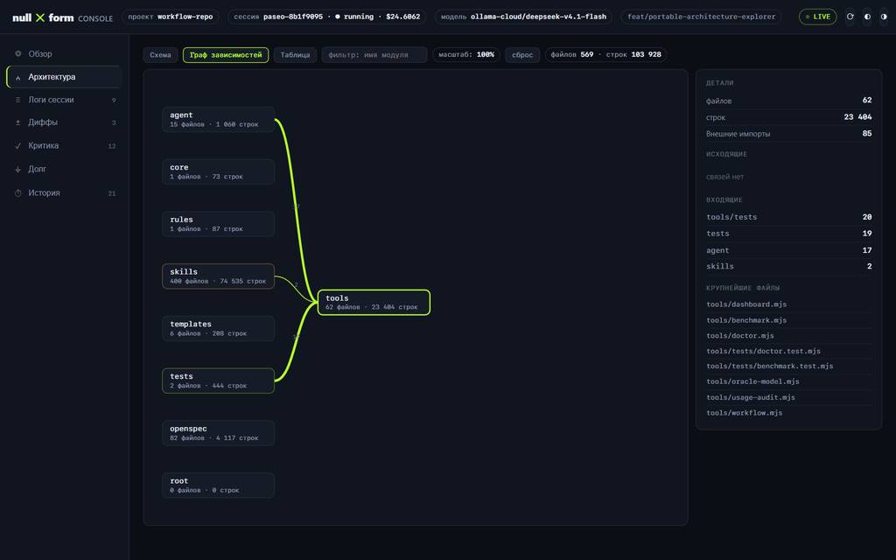

# NULLFORM WORKFLOW

[](https://github.com/wdnameless/nullform-workflow/actions/workflows/repo-gate.yml)
[](https://opensource.org/licenses/MIT)

**Hard gates over promises. Verified tests over "done". Observability over guesswork.**
**Строгие гейты вместо обещаний. Проверенные тесты вместо «готово».**

Portable engineering harness for AI coding agents — 8 roles · 70 skills · 8 host adapters · Windows / Linux / macOS.



## Install

Requires Node.js `>=18.19.0`. Verified `.tgz` (not published to npmjs yet):

```bash
npm install -g --ignore-scripts ./nullform-workflow-1.1.0.tgz
nullform init            # choose your harness: claude · codex · opencode · cursor · omp · openclaw · hermes · openhuman
nullform doctor          # verify installation health
nullform update          # update via npm, no git needed
```

Headless (Cursor rules are project-scoped):

```bash
nullform init --harness opencode --yes
nullform init --harness cursor --project-root . --yes
```

Developers: `git clone https://github.com/wdnameless/nullform-workflow.git && cd nullform-workflow && npm ci`.

## Work in tiers

```bash
nullform doctor
node <installed_root>/tools/workflow.mjs start --tier T1 --task "smoke check"
node <installed_root>/tools/workflow.mjs close
```

| Tier | When | Gate |
|---|---|---|
| **T0** | 1–2 files, trivial fix | Tier declared → `close` |
| **T1** | 3+ files, unfamiliar area | Recon before edits, verify before `close` |
| **T2** | Architecture, new module | Manifest (`R##`) → OpenSpec → blind oracle ACCEPT |
| **T3** | Multi-feature program | T2 per slice |

## Why it works

- **Evidence PRs** — Summary → Evidence (exact command + raw output) → Merge danger → Blast radius. No evidence, no merge.
- **Blind oracle** — independent acceptance against your verbatim requirements and the running product, never against our spec.
- **Session retro** — ranks real session logs by hidden waste (`node tools/session-retro.mjs scan`).
- **JEV hints** — a tiny decision model suggests one installed skill before a turn (≥0.80 confidence, else silence). Cost −93.9% vs a classifier call; details in [`docs/jev.md`](docs/jev.md).

## Reference

- Spec: [`core/PORTABLE.md`](core/PORTABLE.md) · Glossary: [`CONTEXT.md`](CONTEXT.md) · Roles: [`agent/agents/`](agent/agents/)
- Gates: `node tools/verify.mjs --profile verify|audit` · Tests: `node --test tools/tests/*.test.mjs`
- Dashboard: `node tools/dashboard.mjs --url`

## License

MIT
